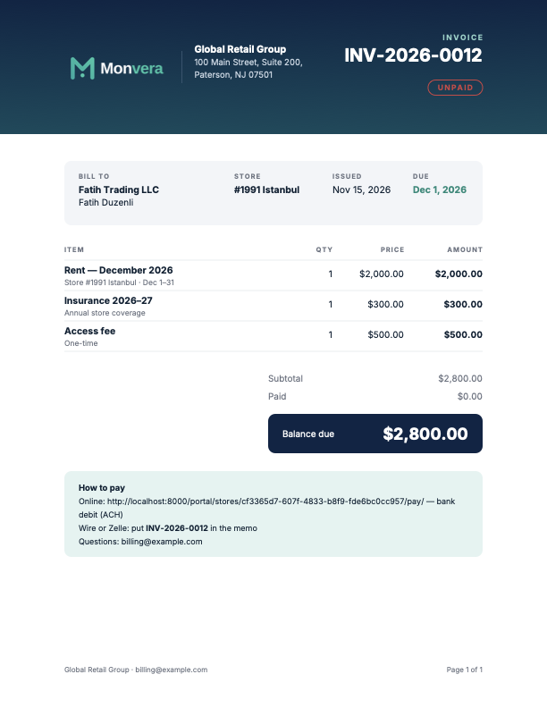
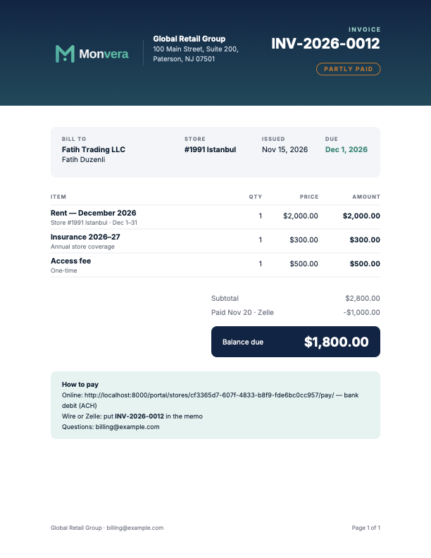
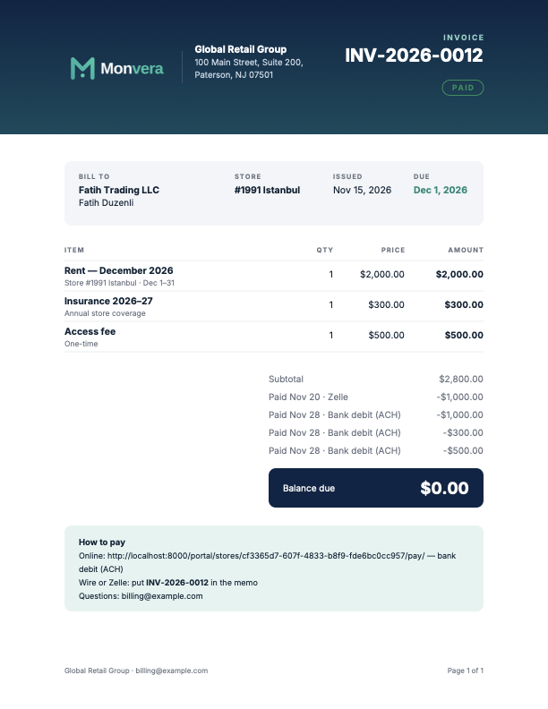
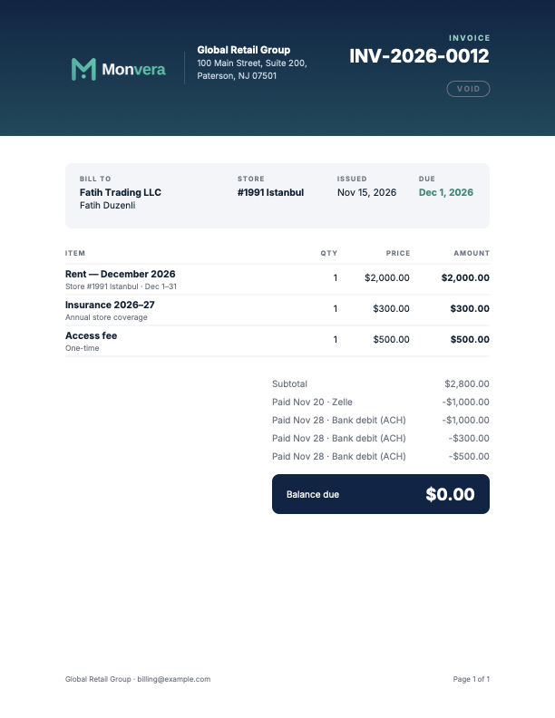
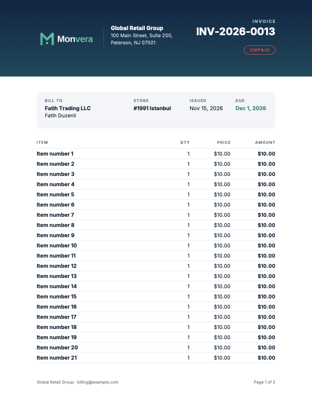
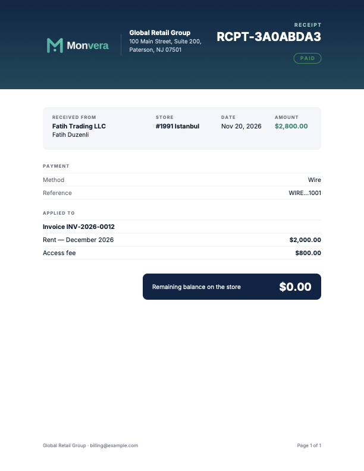

# QA-015 — Design v2 (PLAN-015): the record per batch

Fable's gate record for `docs/qa/PLAN-015-design-v2.md`. One entry per batch: what was built, the
review (Gate 3/4), the tests, the gate at its class, the verdict. The mockup is
`docs/design/dashboard-v2-dark-laptop.png`.

## Batch 0 — the shared components and Appearance Light/Dark (branch `design-v2/batch-0`) — gate class: full

**Built** (Opus, `3174504`, `0880061`, `94e2184`, `3071c9e`, `6eb5ff4`; plan §4.1, §4.4). Components in
`finance/templatetags/components.py`: `` (icon square, title, sub-line, figure with a tone, a
pill badge, a footer link that must be a path of this site), `` (a GET form of submit
buttons; `parse_period` falls back to month), `` (initials: the first letters of the
first two words, 28 or 36 px, hidden from screen readers with the name beside it), `` (tone +
glyph, an unknown tone or glyph refused), `card_head.html`. The sidebar's user card (tile, name, the
role's display, the three links) and the same identity row in the phone's More sheet; the Reports group's
chevron (`
`, open on report pages only). Appearance: `THEMES = ("light", "dark")`, Dark the
default; `accounts/0005` (System → Dark, then the field's choices and default) and `portal/0003` (the
portal's CHECK dropped, System → Dark, the field, the CHECK on light/dark — the portal shares
`accounts.models.Theme`, so plan §3's "portal out of scope" gave way to decision 7); the System twin
block removed from `tokens.css`; signed-out staff and portal pages dark; the sidebar links take a new
token `--sidebar-link` (`--link` in dark, `--sidebar-text` in light, pairs documented). Spec §3 and §7.1,
HANDOFF §1–§4 follow.

**Departures, each with its reason:** `avatar_tile` not `avatar` (the name was taken by the Notes
letter); the initials rule is the mockup's ("HL"), not `workspace_cards.initials`; `status-chip` not
`.chip` (taken by the filter chips); `kpi2-pill`/`kpi2-amount` (the 12c class guard); the refusal reads
"Choose Light or Dark."; the More sheet shows the identity row above its three 44 px rows rather than a
small card.

**Review (Gate 3/4).** Both migrations read: data step before the field change, the portal's CHECK
dropped and re-added around it, reverses restore the choices and leave the rows dark; `_local_path`
refuses `//` and backslashes for the KPI link; the initials strip to letters and never render a name
alone; every chip carries a glyph; one new pair line per theme for `--sidebar-link` and the tile on
`--surface-2`, and a new test that every `pair[dark]:` line meets AA (they do, bar the owner-accepted
3.97). No finding on the diff. The visual world's light users now store Light explicitly (the default
turned Dark), so the light baselines keep rendering light.

**Tests.** `test_plan015_batch0.py` (the user card per role, the More sheet, the chevron on report vs
other pages, both migrations both ways, the new-user and portal defaults, `set_theme`'s refusals,
signed-out staff and portal pages dark, the two-segment controls); the component tests in
`test_design_components.py`; re-pins named: `test_plan012f_shell` (Reports open state, the user card,
the token registry), `test_plan012f_a_adversarial` (sign-out block), `test_plan012g_a_switching` (Dark
defaults, `system` refused), `test_plan012g_a_tokens` (one dark block), `test_design_accessibility`
(signed-out dark), `test_pwa` (one meta), `test_portal` (dark account page, `system` refused),
`e2e/test_theme_12g_a.py`, `visual/world.py`. Route digest, ICON_NAMES and the page lists untouched.
Opus's PostgreSQL run: 1,061 passed, 2 round-trip tests timed out at 600 s on a Docker daemon that had
stopped answering (restarted before the gate; the gate's run is the one that counts).

**Gate (`93590b0`, main merged in), 2026-11-05.** ruff, format, mypy, lock, makemigrations (sqlite,
PostgreSQL), `check-no-secrets` 0; sqlite **9,710 passed**; PostgreSQL migrations **36** (`accounts/0005`
and `portal/0003` both ways), units **10,489**; e2e **96 ×4** (four WebKit params skipped locally; CI runs
them); visual regenerate 160, compare **164 + 164**. 80 baselines moved, all in the sidebar (the user
card, the Appearance control, the Reports chevron — open with its sub-items on the Reports page) or on
the sign-in pages (now dark), read by eye in both themes and widths; two shots by noise only, not
committed. The Docker daemon stopped answering before this gate (a 21-day uptime): restarted, the
PostgreSQL stages ran on the fresh engine. **Verdict: PASS.**

## Batch 1 — the dashboard as the owner's mockup (branch `design-v2/batch-1`) — gate class: full for runs 1–2, small change from run 3 (owner, 2026-11-06: UI-only work)

**Built** (Opus, `9971217`…`4b65fe6`; plan §4.2–§4.3, the owner's §9 decisions). The header: "Dashboard"
with "Collections and balances for <Month YYYY>", the period control (This month · Quarter · Year,
scoping the four KPIs), and for billing and above Download spreadsheet, New invoice (secondary) and the
primary Record payment (the search page's `?intent=record_payment`, "Add payment — which store?", one
match jumping straight to the store's Add payment). `ledger/services/dashboard_v2.py`: `kpis` (Due from
Revenue by month's billed total, stores and the next due day; Collected from Payments by method with the
percent of Due and the change against the previous period; Overdue = Aging's total less its Current
bucket with the stores, the oldest days and "· n need attention"; Bank deposits from the new
`banking.services.summary` — the period's credits, "<institution> ····<mask>" or "no bank connected", the
New count as the badge), `collections` / `collections_by_year` (the inline-SVG bar chart,
`` in `finance/templatetags/charts.py`, the current month in `--green`, the tooltip
from `data-*` through `textContent`, `<title>` without JS, Monthly · Yearly by `?chart=`),
`operator_tiles` (2 × 2, by balance then name, chips Paid up / Overdue n days / Partial / Promise · day /
Due · day), `activity` (the seven kinds plus Needs attention, the last 90 days, at most 200 rows per
source, `q` through `search.clean_query`, 5 a page with the lists' footer). The mini calendar stays beside
the feed. Moved to Admin › Daily charges (`run/_operations.html`, same ids): Today's run, Failed payment
attempts, Invoices created but not sent, Last nightly check, the waived-with-a-live-invoice card.
Removed with their services, tags, partials and CSS: Cashflow, Payment status, Recent payments, the
Needs attention card. `ledger:dashboard_export` (`/dashboard.csv`, read-only, billing in the view): the
four KPI rows then every activity row of the current search and kind. Phone: KPIs two a row, tiles one
column, the bars scroll inside their card, feed rows as cards, the calendar after the feed. Spec §4 and
§7.5 rewritten.

**Departures, each with its reason:** "Record payment" is the one allowed exception to the copy pass
(owner's decision 3); a kept promise shows "Promise to pay ✓ Kept"; a lease ended on a re-let store reads
"○ Ended"; a broken promise is dated the day after its promise; Needs attention rows in the feed carry no
Kept / Reschedule / Broken buttons (the operator page's banners keep them); Overdue is a balance as of
today, the same in every period; the Collections and Activity card headers use the `.card-head` classes
directly (a control on the right); the `unpaid` badge tone added to `kpi2`.

**Review (Gate 3/4).** No defect in the diff: every query parameter parsed to a known value (period,
kind, page digits, `q` cleaned), the figures under the reports' statement timeout, the export read-only
in the registry and billing-checked in the view, the intents whitelisted, the chart built with
`format_html` and the tooltip with `textContent`, no provider literal. Noted: the page reads `pnl.rows`
twice (Due and Collections; query budget 86 → 100 at the same shape); the leftover
`payment_status_period` route and field and the frozen chart tokens stay (a route or model change is out
of this batch).

**Tests.** `test_dashboard_v2.py` (83: each KPI against its report for month / quarter / year, the
change badge, the percent, the attention count, the bank card with and without a connection, the chart's
months, flag, tooltip and Yearly, the tiles' order and chips, each activity kind and chip, search, the
kind filter, paging edges, the empty state, the export's rows and name, the viewer and billing headers,
the moved cards on Daily charges, the removed cards absent, the query count, the timeout, accessibility,
Rule 8, the adversarial cases); `e2e/test_dashboard_v2.py` (4 on Chromium, WebKit in CI). Re-pins and
moves named per commit: the moved operations tests, the Needs-attention card tests re-pointed at
`?kind=attention`, the deleted cashflow / range / donut / payment-status / recent-payments tests, the
budgets (86 → 100, 89 → 103), the header and search tests, the CSV route lists. Opus's one full sqlite
run: 11 failed — 8 pins fixed, 3 e2e "database table is locked" failures while another suite ran on
the machine (the gate's e2e ×4 decides).

**Gate (`d933a49`, main merged in), 2026-11-05/06.** Run 1 (`4b65fe6`): static, sqlite **9,683** and
PostgreSQL migrations green; the PostgreSQL unit selection found one real defect — the dashboard answered
with **103 queries** on the volume set against its bound of 89 (the P&L rows read twice; the open balances
read three times). Fixed (`48642b0`, MAJOR): `page_reads` reads the P&L rows and Payments by method once
over one range covering the period, the period before and the chart; the open balances are read once and
shared by the KPIs, the tiles and Needs attention — **81 queries** (0.80 s) on PostgreSQL, 76 / 79 on the
sqlite budgets (re-pinned down from 100 / 103). Then main (the identity change) merged in (`d933a49`: the
route digest at 319 naming both new routes). Run 2: green through every stage (sqlite **9,721**; PostgreSQL **36** / **10,500**, the dashboard at 81
queries; e2e **98 ×4**; visual 160 / 164 + 164) but its regenerated baselines showed three layout defects —
the feed's rows as stacked blocks at 1280 px (a class-name clash with the audit list's `.activity-row`;
MAJOR), the period control stacked into three rows at 390 px (the phone's full-width button rule;
MAJOR), a KPI figure wrapping inside its number at 390 px (MINOR) — fixed (`9863284`: `.feed-row`, the
phone rules for the control and the 22 px no-wrap figure with the grid falling to one card, and e2e
assertions for each). Run 3 (`9863284`) began as a full gate (sqlite **9,721** green; the PostgreSQL migration selection 14
minutes in) and was stopped at the owner's word of 2026-11-06 — UI-only work takes the small-change
class from here. Small gate on `9863284`: lint, types, lock, makemigrations, the secret scan 0; thirteen
targeted test files **715 passed** on sqlite; the PostgreSQL performance bound and the dashboard tests on
PostgreSQL **85 passed** (81 queries); e2e once on PostgreSQL **98 passed** (8 WebKit params in CI); the
dashboard and Daily charges baselines regenerated and every page compared on both databases
(**164 + 164**). Read by eye in both themes and widths against the mockup: the four KPI cards, the
Collections chart, the operator tile, the feed as a six-column table at 1280 and as cards at 390, the
period control on one row, the calendar beside the feed, the four cards on Daily charges. One MINOR
deferred with this written decision: at 1280 the widest status chip ("● Due Oct 23, 2026") touches the
feed card's right edge — cosmetic, to be taken with the owner's review notes rather than another cycle.
The PR's CI runs the full suites before the merge. **Verdict: PASS.**

## PLAN-015a — the Edit lease page in the New lease family (owner, 2026-11-06) — gate class: full

**What.** The Edit lease page is four cards in the New lease style (Lease as read-only facts with the
transfer and lease-end wizards' links; Rent with "Change rent", the effective date defaulting to the next
rent due date, the proration switch until the first month is billed, and the history; Collection with
the debit day 1st–28th, Twice a month and the three channel cards; Billing details as a read-only
summary with the dialog's link) beside a sticky Changes card that lists each pending change as
"old → new", enables Save only when something changed, and warns in one line when an autopay would be
marked Needs review. Store, operator, start date and status are no longer fields: a posted value is
ignored. The plan is `docs/qa/15/PLAN-015a-edit-lease.md`; built by Opus (`de67d2e`..`4f52331`);
no model, migration or route changed (FROZEN_ROUTES 320).

**Findings.**
- [MAJOR, fixed `dc326f5`] `services/leases.py planned_debits` raised on a lease without a debit day
  (zip strict), so `update_lease` answered 500 for any such lease. Pre-existing on main (Fable's probe);
  reachable from the new page's "—" choice on a paused lease. Now plans nothing; a live provider
  schedule is then marked Needs review. Four tests fail without the fix.
- [MAJOR, fixed `5fa186b`] The Rent card held two lines of help once the first month was billed
  (one-line help rule, PLAN-012e2 D10): the billed state is now a facts row.
- [MAJOR, fixed `5fa186b`] `test_store_views::test_the_second_debit_day_renders_empty_by_default`
  looked for an input; re-pinned to the select (no `required`, only the blank option selected).

**Fable's adversarial tests** (`test_edit_lease_adversarial.py`, `5162c03`): a new rent with the default
date on a lease whose next rent is already booked is refused on the date field and the history keeps
its rows; dated after the booked row it replaces it; a POST without the CSRF token is 403 and changes
nothing; a billing company name carrying markup is escaped; a day above the 28th other than the
current one is refused.

**Gate (full, `5fa186b`).** Run 1 (4f52331) was stopped by Fable at the sqlite stage for the planned_debits finding; run 2 (5162c03) stopped at the full sqlite suite with the two findings above (9,817 passed); run 3 on `5fa186b`, from `docs/qa/tools/launch-gate.sh`: ruff, format, mypy strict (675 files), `uv lock --check`, makemigrations on sqlite and PostgreSQL, the secret scan — all 0; the full sqlite suite **9,819 passed**, 818 skipped; PostgreSQL migration selection **36 passed** (49 min), unit selection **10,598 passed**, e2e **104 passed ×4** (8 WebKit params in CI); the four `edit-lease` baselines regenerated on PostgreSQL (Opus's sqlite-written ones replaced) and every page compared on both databases (**172 + 172**); the laptop and phone shots read by eye in both themes against `docs/design/new-lease-dark-laptop.png` (the phone shot carries the fixed Save bar and the bottom navigation across the full-page capture, as every form page's phone baseline does). The PR's CI runs the full suites before the merge. Residual risk: the e2e sign-in helper's network-idle wait (`4f52331`) answers a sqlite-only 401 Opus saw once; on PostgreSQL the suite passed four times. **Verdict: PASS.**

**Open questions for the owner.** (1) With Status gone from the form, pausing collection and moving a
prospective lease to active have no other staff page. (2) The history shows every row (no cap).

## PLAN-015b — lease activation, Pause and Resume collection, the rent history cap (owner, 2026-11-07) — gate class: full

**What.** (A) The daily job makes a prospective lease active on its start date (`leases.activate_due`,
before the rent run; the line ends "Leases activated: N (M waiting on details)."); the LEASE card offers
"Activate now" (billing) for an early start: the start date and the only rent row move to today, the
first month is billed, audited `lease.activated`. (B) "Pause collection" (billing; a required reason
through the WaiveForm pattern, payment data refused and never echoed back) sets the lease Paused,
audited `lease.collection_paused` with the reason; while paused no reminder A–E is queued or sent
(`LeasePaused`), no autopay plan occurrence and no automatic re-debit is made, and the autopay pause
is queued as a worker job when autopay was on; "Resume collection" sets it Active, queues the autopay
resume when the pause had paused it, and charges the months inside the pause (collection paused, rent
owed — §8 Q2). The LEASE card has a Status row with the badge, the action for the status and "Paused
since <date> — <reason>"; Notes & follow-ups gains the kind "Lease status" (the three audit actions)
with its filter pill. (C) The Edit lease history shows five rows, the rest behind "Show all (N more)".
Three routes (FROZEN_ROUTES 320 → 323), no model or migration. The plan is
`docs/qa/15/PLAN-015b-lease-status.md`; built by Opus (`e46b50d`..`2461cfb`).

**Opus's choices Fable accepted.** Suppression at the send is a new `LeasePaused` reason (the ended
lease's hook at messaging:566 only words a sentence); the store page's header shows the store's
upcoming prospective lease when it has no current one (`Header.status_lease`), so "Activate now" is
reachable; a paused lease that lost a requirement is refused on resume with the blocker's sentence; a
pause form with a card number is held and dropped, never re-rendered.

**Fable's adversarial tests** (`test_lease_status_adversarial.py`, `36c5ea5`): an Edit lease save while
paused bills nothing and the resume bills the three months; a legacy paused lease with no pause row
resumes and queues no autopay; a POST without the CSRF token to Resume and to Activate is 403 and
changes nothing. A fourth expectation — an archived operator blocks activation — was dropped:
archiving an operator does not check its leases today, so no rule backs it (recorded below).

**The owner's decisions (§9, 2026-11-07), applied before the merge.** (1) The New lease page saves a
lease that starts after today as Prospective (`d8e9260`); with option (a) the move-in draft is made for
a prospective lease too (`5dc4824`): its send bills the start month, and the daily job on the start date
or "Activate now" adds no second charge (tests in `test_new_lease_page.py`, the ten move-in tests kept
their dates). (2) Resume collection is a dialog whose first line reads "Resuming will bill N paused
months: $X." or "Resuming will bill nothing." from `rent_run.months_resume_would_create` (`e45c604`).
(3) Pause and Resume collection are admin only; Activate now stays billing (`5baad81`). (4) The card
reads "Pause" / "Resume" (`324d48f`). (5) A queued autopay pause/resume job carries the collection
status it was queued for (`Job.params`); on a mismatch under the row lock it sends nothing, finishes
done as skipped and audits `lease.autopay_pause_stale` / `lease.autopay_resume_stale`; the admin
autopay routes carry none (`1fb4a0b`; tests in `test_jobs.py`, incl. pause → resume → stale pause job).

**Findings.** [MAJOR, fixed `9fd60af`] `test_outbox_preview.py` built its stand-in lease with the Paused status, which §3 B now skips: the fixture became an active lease starting after the window (the five tests keep their assertions) and a paused-lease case was added (listed as "Skipped: collection is paused", queues nothing, counted as skipped).

**Gate (full, `36c5ea5`).** Gate run 1 (36c5ea5) was stopped by Fable for the owner's §9 decisions; run 2 (d8e9260) stopped at the full sqlite suite with the Outbox finding (9,962 passed); run 3 (9fd60af) was interrupted in its visual stage by the owner's shutdown and rerun from the start on `90db7ae` (the STATUS commit): ruff, format, mypy strict (677 files), `uv lock --check`, makemigrations on sqlite and PostgreSQL, the secret scan — all 0; the full sqlite suite **9,968 passed**, 818 skipped; PostgreSQL migration selection **36 passed**, unit selection **10,747 passed**, e2e **104 passed ×4** (8 WebKit params in CI); the Edit lease, store and New lease baselines regenerated on PostgreSQL (44) and every page compared on both databases (**172 + 172**); one baseline (`store-log-contact-390.png`) differed from Opus's copy and is committed from the gate; the store page read by eye at both widths (the Status row with the Active badge; the visual world signs in as billing, so no Pause link). The PR's CI runs the full suites before the merge. **Verdict: PASS.**

**Residual risk and the owner's decisions.**
- A pause job that fails at the provider leaves autopay on while collection is paused (the job's own
  failure path, unchanged; the Outbox/jobs page shows it).
- "Activate now" in an earlier month than the start after the move-in invoice was sent: the start
  moves, November is charged prorated, December's charge stays prorated from the old start (not a
  second charge; its amount no longer matches a lease that started in November). Owner question.
- "Activate now" before the move-in draft is sent: the catch-up charges the start month; the send is
  then refused with LINE_RENT_AMOUNT until staff edit the draft (existing builder behaviour).
- An archived operator does not block activation (archiving does not check leases either).

## PLAN-015c — one invoice PDF, receipt PDFs, downloads, invoice e-mails behind a setting (owner, 2026-11-07) — gate class: full

**What.** One invoice PDF rendered on request (reportlab, Letter, Inter embedded, deterministic
bytes): the gradient band with the company's logo copy (the Monvera PNG as fallback), name and
address, "INVOICE" and the number, the UNPAID / PARTLY PAID / PAID / VOID stamp; Bill to, Store,
Issued, Due; the lines with the header row repeated on every page; Subtotal, one row per payment,
the dark Balance due box; How to pay (the portal pay page, the memo line, the support e-mail); the
footer "<company> · <support e-mail> · Page x of y". A receipt PDF per payment entry (RECEIPT, PAID;
the entry is the rows of one recording on the lease; method, the masked reference, the cached last
four only for a bank debit; Applied to; the store's remaining balance). Downloads: staff
`invoices/<pk>.pdf` and `payments/<pk>/receipt.pdf` (any role, audited); portal
`/portal/invoices/<pk>.pdf` and `/portal/payments/<pk>/receipt.pdf` (the operator's own only, the
portal's 404 otherwise, audited with the portal user); links on the store tabs, the invoice and
payment pages, the portal pages; the portal status gains "Partly paid". Company settings gain the
address, "Invoice e-mails sent by" (the processor by default / the company) and the logo's PNG copy
(migration 0071, reversible, refusing while invoice or receipt messages exist). With the company
sending, the provider is asked for no e-mail: the app queues the invoice e-mail with the PDF, the
portal link and the hosted link, and marks the invoice sent; a receipt e-mail goes for payments
recorded outside the processor. ADR-0020; `docs/CLAUDE.md` §5 amended. Built by Opus
(`e831ae1`..`5542015`); FROZEN_ROUTES 323 → 327.

 
 
 

**Findings.**
- [MAJOR, fixed `5542015`] A wire, Zelle, check or cash entry recorded across several invoice lines
  is several `Payment` rows sharing an allocation group; receipts were per row, so one transfer gave
  several receipts and e-mails. Now one receipt per entry (the group's rows on the lease; a split
  bank deposit gives each store its own), numbered from the entry's first row; one e-mail per entry,
  queued after every row exists so the body carries the sum; the links appear once per entry.
- [MINOR, accepted] The "How to pay" panel sits below the totals, not beside them as in the mockup.
- Opus's self-review found and fixed: the PDF geometry without float (the schema rule), the invoice
  pages' query budget (the company row read once per request), three test-hygiene re-pins.

**Decisions taken.** `preview(company=)` accepted as a small interface addition. A lease with no
billing e-mail gets a HELD invoice message (the Outbox shows it; staff add the address and release),
as every reminder does — pinned by Fable's test. The entry is bounded by the lease (a split deposit
never shows another store's charges). The hosted pay link is the processor's payment page URL plus
the invoice id, per its docs — **TODO-VERIFY-074** against the sandbox.

**Fable's tests.** `test_plan015c_adversarial.py` (`dff19c6`): a portal session on the staff download
routes is 401 with no PDF and no audit; a staff session on the portal routes gets the portal's answer;
with the company sending the builder path asks the provider for no e-mail and a later switch back
un-sends nothing; the held message above. `conftest.py` (`77faa03`): the URL configuration loads once
under the default environment before any test — a test that set `STAX_ENV=live` first (since
2026-10-30) left every later route test one route short; proven failing before, passing after.

**Gate (full, `dff19c6`, main `85bb59e` merged in).** From `docs/qa/tools/launch-gate.sh`: ruff, format, mypy strict (693 files), `uv lock --check`, makemigrations on sqlite and PostgreSQL (0071 applied), the secret scan — all 0; the full sqlite suite **10,096 passed**, 838 skipped; PostgreSQL migration selection **36 passed** (0071 forward and back), unit selection **10,895 passed**, e2e **104 passed ×4** (8 WebKit params in CI); visual: the store, settings, portal, payments and invoice baselines regenerated on PostgreSQL (52), then the compare found eight pages outside that set changed by the work — Message templates (the two seeded templates listed) and the payment and void-payment pages at phone width (the Receipt PDF button) — read by eye and regenerated on PostgreSQL (12); every page then compared on both databases **172 + 172**. Twenty baselines committed. Opus's accidental full run (sqlite, 34 min, during the 015b gate) is recorded: it surfaced six real failures Opus fixed before the gate. The PR's CI runs the full suites before the merge. **Verdict: PASS.**

**Residual risk.** The hosted link (TODO-VERIFY-074); mail is not live, so every invoice and receipt
message is held until the owner's Gmail delegation lands; a partial void of a multi-row entry keeps
the entry's receipt about its first row.

**PR #58's first CI run and gate run 2.** The PR's run went red in unit shard B on PostgreSQL:
`test_plan015c_receipt_entries::test_a_two_line_wire_has_one_receipt_with_both_charges_and_their_sum`
— the receipt's "Applied to" lines followed the payment rows' creation order (`created_at`, then the
random pk on a tie), so a two-line wire rendered "Access fee" before "Rent" on PostgreSQL and the
reverse on sqlite: the same entry, different bytes by database.
- [MAJOR, fixed `1299d4a`] `receipt.applied_order`: the lines follow the invoice (by number), then the
  charge's invoice line position, then the charge kind and words, then the pk — no timestamp; the
  entry's first row (the RCPT number and the link) is the smallest pk when timestamps tie. A new test
  writes the same entry with the rows in either order and asserts identical bytes; both tests fail
  against the old code. Targeted tests 78 passed on sqlite and on PostgreSQL.
- Gate run 2 on `1299d4a`: the fast checks 0; the full sqlite suite **10,097 passed**; PostgreSQL migration selection **36**, unit selection **10,896 passed**, e2e **104 ×4**; the visual set regenerated on PostgreSQL (64) with no baseline change and every page compared on both databases (**172 + 172**). **Verdict: PASS.**
